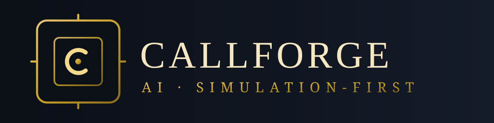

# CALLFORGE AI

CALLFORGE AI by AgentRunMe is a simulation-first UAE business calling and AI receptionist platform. Brand identity: [`docs/brand/BRAND.md`](docs/brand/BRAND.md).

The repository was reconstructed from the supplied v0.2 specification because the original source bundle was not found during Phase Zero discovery. It must not be treated as equivalent to the missing original implementation without a feature-by-feature comparison.

Live telephone calling, production deployment, customer billing, public plugin publication, and real customer data processing are disabled or out of scope until separately authorized.

## Local verification

Requirements: Node.js 24.22.2 and Corepack/pnpm 12.18.0.

    corepack enable
    pnpm install --frozen-lockfile
    pnpm typecheck
    pnpm lint
    pnpm format:check
    pnpm test
    pnpm audit

`pnpm start` launches the local stdio MCP process. `pnpm demo` loads and displays deterministic simulation fixtures. Neither command performs live telephone calls.

## Evidence

See `BASELINE_AUDIT.md`, `SECURITY_GAP_ANALYSIS.md`, `MILESTONE_LEDGER.md`, and `milestone-ledger.json`.
